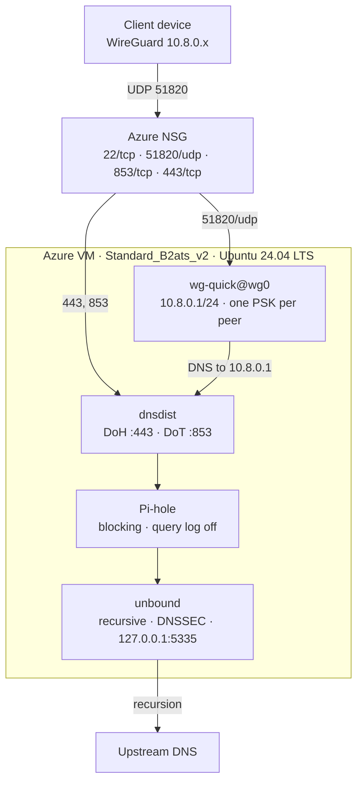

# oh-my-vpn

WireGuard VPN and a private DNS resolver on one Azure VM, provisioned with Terraform. The VM runs WireGuard, Pi-hole, unbound and dnsdist, so every connected device resolves through a resolver you control.

Status: feature-frozen personal deployment, last updated 2026-11-12. No CI and no automated tests; `terraform validate` is the only check. Expect security fixes only.

## What it runs



Clients send DNS to `10.8.0.1`, and the server is configured to forward it through dnsdist, Pi-hole and unbound in that order. ufw denies public plaintext DNS on port 53, and fail2ban guards sshd with bans applied through ufw.

## Why this setup

DNS for tunnel clients ends at a resolver you own. Public plaintext DNS is denied at the firewall, so a device on the tunnel cannot quietly fall back to `8.8.8.8`. unbound recurses from the VM itself and validates DNSSEC, so no third-party resolver sees which device asked what. Pi-hole blocks ads and telemetry for every device that joins, and it runs with query logging disabled and privacy level 3 in `templates/cloud-init.yaml.tftpl`.

The DoH and DoT listeners let a device use encrypted DNS without the tunnel, which is how iOS and Android profiles work.

It costs one VM, one static public IP and one 30 GiB disk. There is no managed VPN gateway, NAT gateway or load balancer.

It is for one person or a small team on Azure who wants the tunnel and private DNS from a single host and can tolerate downtime. The Terraform targets `azurerm`; there is no AWS, GCP or bare-metal path.

Use something else when you need high availability or multi-region failover: this is a single VM and a single point of failure. If you only want the tunnel and not the DNS stack, a plain `wg-quick` server is much less to operate.

## Prerequisites

- Terraform 1.5 or later.
- Azure CLI, logged in and pointed at the right subscription:

  ```bash
  az login
  az account set --subscription "<subscription-id-or-name>"
  ```

- An SSH key pair.
- A domain you control, set in `server_domain_name`, with an `A` record pointing at the VM's public IP. Terraform creates that IP, so add the record after the first apply.
- A WireGuard client on each device. `qrencode` on your workstation if you use the Terraform-generated configs.

## Deploy

```bash
cp terraform.tfvars.example terraform.tfvars
# set ssh_public_key
# set server_domain_name and admin_ssh_allowed_cidrs for real use
terraform init
terraform plan
terraform apply
```

Defaults live in `variables.tf`: `austriaeast`, `Standard_B2ats_v2`, admin user `lynicis`, `dns.lynicis.dev`, UDP `51820`, and `peers = {}`.

Azure takes a few minutes, then cloud-init installs packages and starts the services. Check it:

```bash
$(terraform output -raw ssh_connection_string)
cloud-init status --wait
sudo wg show
sudo systemctl status wg-quick@wg0 dnsdist pihole-FTL unbound
```

Create the DNS record next: `A <server_domain_name>` pointing at `terraform output -raw server_public_ip`.

Then read the server key, which cloud-init generated at boot:

```bash
sudo cat /etc/wireguard/server_public.key
```

Paste it into `wireguard_server_public_key`, add your `peers`, and apply again. The default in `variables.tf` belongs to the author's deployment, and Terraform cannot know a key that does not exist until the VM boots, so the second apply is required before generated client configs contain the right server key.

## Clients

There are two ways to add a device. Pick one per device; using both for the same name creates two key pairs for the same address.

### On the server

```bash
$(terraform output -raw ssh_connection_string)
sudo add-wg-client phone
```

The script allocates the next free `10.8.0.x` address, generates a key pair and PSK, enrolls the peer on the live interface, appends it to `wg0.conf` so it survives a reboot, writes `/etc/wireguard/phone.conf` and `/home/<admin_user>/wireguard-clients/phone.conf`, and prints a QR code. Copy the config off with:

```bash
scp lynicis@$(terraform output -raw server_public_ip):~/wireguard-clients/phone.conf .
```

A peer added this way exists only on the VM. It is not in Terraform state, and a rebuilt VM loses it.

### In Terraform

```hcl
peers = {
  laptop = { ip = "10.8.0.3" }
}
```

`terraform apply` writes `clients/laptop/`:

- `wireguard.conf`
- `apple-doh.mobileconfig` and `apple-dot.mobileconfig`
- `dns-setup.txt`

This path does not touch the server. Enroll the peer by hand, using the public key from Terraform and the PSK from the generated config:

```bash
terraform output -json peer_public_keys
grep PresharedKey clients/laptop/wireguard.conf
```

On the VM:

```bash
sudo wg set wg0 peer '<peer-public-key>' allowed-ips 10.8.0.3/32 preshared-key <(echo '<psk>')
sudo wg show
```

Then append the same `[Peer]` block to `/etc/wireguard/wg0.conf`. `wg set` does not persist, and the interface uses `SaveConfig = false`.

`client1` is created by cloud-init, not by Terraform. If you list it under `peers`, supply its existing `private_key`, or Terraform generates a second key pair the server has never seen.

QR codes for Terraform-generated configs come from `terraform output client_qr_commands`, which prints one `qrencode` command per peer.

## Encrypted DNS

Out of the box the DoH and DoT listeners serve a self-signed certificate, so clients that validate the chain reject them. See Known gaps for the fix.

```bash
terraform output doh_url
terraform output dot_endpoint
```

- iOS and macOS: install `clients/<peer>/apple-doh.mobileconfig` or `apple-dot.mobileconfig`.
- Android: Settings, Network and internet, Private DNS, provider hostname `<server_domain_name>`.
- Browsers and other systems: the DoH URL and DoT endpoint are in `clients/<peer>/dns-setup.txt`.

The DoH path ends in a secret (`doh_secret_path`, or a random 8-character hex value when unset). Changing it requires replacing the VM; see Known gaps.

## Operations

```bash
sudo wg show                       # peers and handshakes
sudo journalctl -u dnsdist -u pihole-FTL -u unbound -n 100
sudo systemctl restart dnsdist     # after a certificate change
sudo ss -lntup | grep 5335         # unbound listens on loopback only
```

`terraform.tfstate` contains every generated peer private key and PSK. It is gitignored, so back it up somewhere secure, and treat `clients/` the same way.

## Known gaps

- The TLS certificate for DoH and DoT is self-signed, generated at boot. Clients that validate the certificate chain, including Apple devices, reject it. To fix it on a Cloudflare-managed zone, issue a real certificate and restart dnsdist:

  ```bash
  # on the VM, after writing a Cloudflare API token to /root/.secrets/cloudflare.ini
  sudo certbot certonly --dns-cloudflare \
    --dns-cloudflare-credentials /root/.secrets/cloudflare.ini \
    -d <server_domain_name>
  sudo /etc/letsencrypt/renewal-hooks/deploy/dnsdist.sh
  ```

  The deploy hook already exists and copies the certificate into place.
- `lifecycle.ignore_changes` covers `custom_data`, so changing `server_domain_name` or `doh_secret_path` does not reconfigure a running VM. Replace it with `terraform apply -replace=azurerm_linux_virtual_machine.wireguard`.
- dnsdist binds the private address `10.0.1.4`, while the NIC uses a dynamic private IP. Confirm the address with `ip -4 addr show` and edit `/etc/dnsdist/dnsdist.conf` if the VM landed elsewhere.
- One VM serves the tunnel and DNS. There is no failover; if the VM stops, both stop.

## Teardown

```bash
terraform destroy
```

This deletes the resource group contents and ends billing. Local files under `clients/` remain.

## Licence

MIT. See [LICENSE](./LICENSE).
